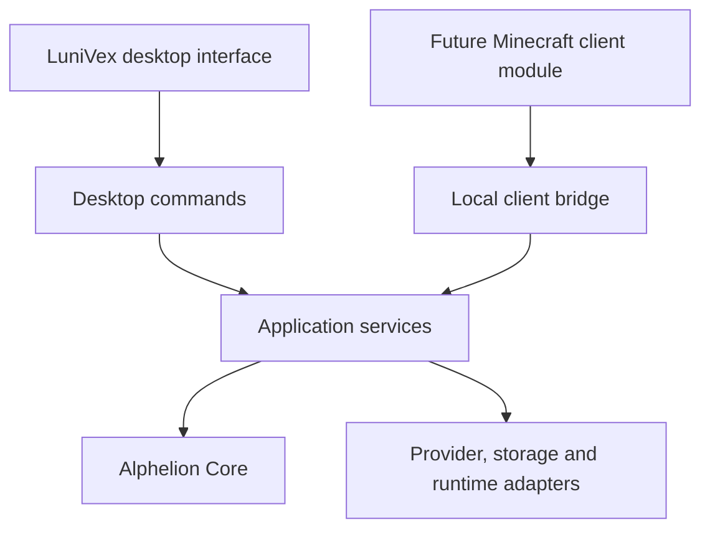

# Alphelion and LuniVex Client

LuniVex is moving toward a full Minecraft client. The desktop application will
handle accounts, installation, updates and launching. A separate game module will
later provide the LuniVex menu, settings and HUD inside Minecraft. Alphelion is the
Rust core underneath that work; Minecraft continues to run the game itself.

This foundation starts from the pending 1.1.1 fixes, on a separate branch. Those
fixes still need their installation/launch test. This step does not include a new
client release or an in-game menu.

## Structure

The core owns rules and decisions. Application services coordinate tasks, and
adapters perform network requests, filesystem work, database queries and process
launches. The interface presents progress and sends user requests. It does not
decide whether a file is valid or an installation is complete.

The in-game interface belongs in a separate Minecraft module. It must not receive
Microsoft access tokens, execute arbitrary desktop commands or require a new
LuniVex account. Its future local bridge will expose an explicit, versioned set of
operations using a per-launch session, rather than the whole desktop API.

## First working boundary

`packages/alphelion-core` is a Rust library with no interface framework, network
client, Java build, database, global application state or telemetry. Its first
module checks file sizes and SHA-1/SHA-512 checksums. Verification reports which
checks were possible when provider metadata is incomplete.

The current CurseForge adapter delegates those checks to Alphelion. It still
handles CurseForge metadata, archive validation and user-facing errors. Download
recovery and instance ownership stay in the compatibility layer until their own
migration has tests.

This is the first extracted part of the engine, not a complete engine rewrite.
The existing `theseus` library remains the working compatibility layer.

## Next boundaries

| Area | Responsibility | State |
| --- | --- | --- |
| Integrity | Size and checksum verification shared by providers | Implemented |
| Installation | Plans, saved progress, manual files and completion rules | Next extraction |
| Instances | Client profiles, local content and configuration ownership | Planned |
| Runtime | Java selection, launch arguments, processes and logs | Planned |
| Providers | Minecraft, Microsoft, Modrinth and CurseForge integrations | Existing adapters; migrate gradually |
| Game module | Main menu, settings, HUD and version-specific integration | Later milestone |

Keep these as modules until separate packages have a concrete dependency or build
reason. Empty packages for every possible feature would create maintenance work
before there is a feature to maintain.

## Migration and release checks

1. Finish the 1.1.1 installation/launch test independently.
2. Extract one working rule or service at a time, with the existing adapter using it.
3. Move installation planning and saved-job rules behind provider-independent APIs.
4. Build an isolated LuniVex Client profile and test its update/repair path.
5. Choose one Minecraft version and loader for the first game module.
6. Add the game menu, then settings and HUD. Expand compatibility after testing.

The desktop interface can remain on its current framework during extraction.
A native Rust interface can be evaluated against the same core later. Switching
renderers is a separate decision from making the engine independent.

Client updates must preserve worlds and user-owned configuration. Missing files,
blocked downloads, authentication errors and network errors need distinct results.
Telemetry, remote AI and optional integrations are separate opt-in features, not
requirements for the core or a condition for playing Minecraft.

## Reference and identity

[OneLauncher's workspace](https://github.com/Polyfrost/OneLauncher/blob/main/Cargo.toml)
is the architectural reference: distinct responsibilities for the app, content,
accounts, Java and game services. This implementation uses original LuniVex code;
no OneClient code or branding has been copied.

LuniVex remains the client name; Alphelion remains the core name. Logo studies in
`design/brand` explore an orbital/stellar identity in monochrome. Selecting a
symbol comes before selecting a replacement palette or applying it to the app.
